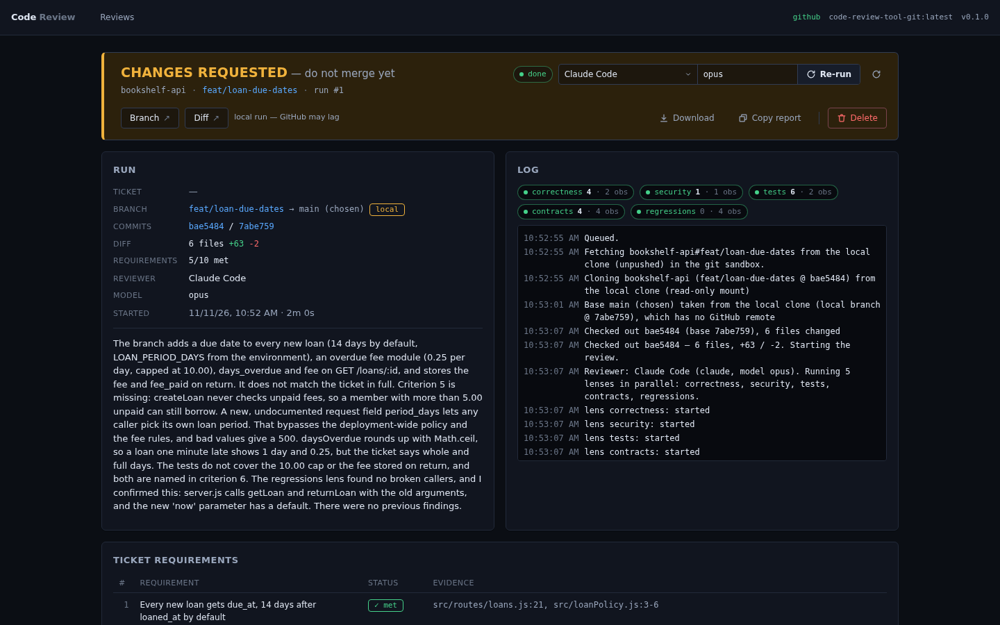
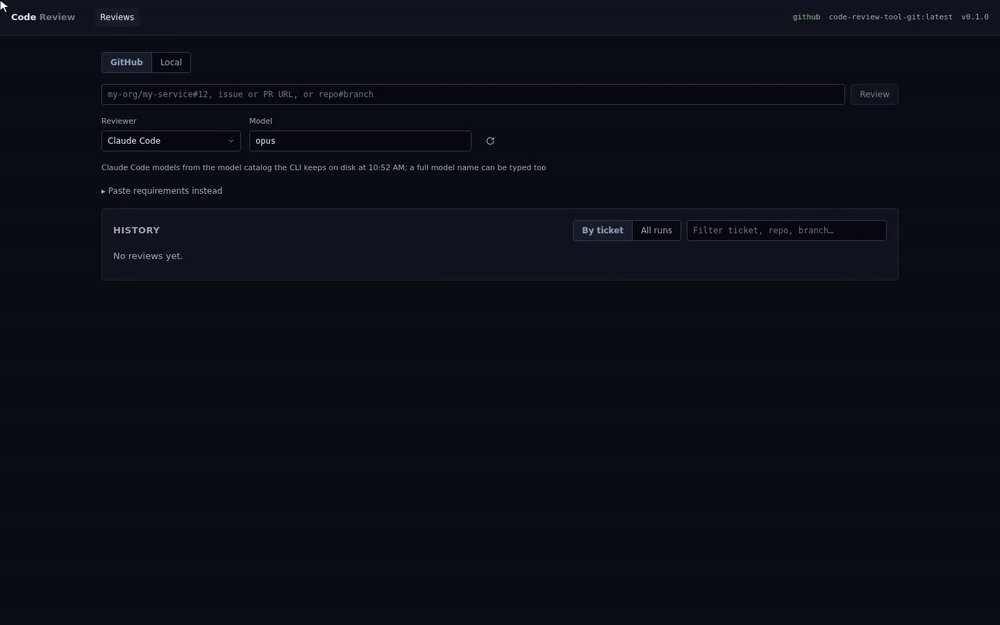

# code-review-tool

A local, read-only code reviewer that checks a branch against its ticket requirements, using the agent CLI you already have.



Give it a ticket key, a GitHub pull request URL, `repo#branch`, or
`local:repo#branch` for a branch that is not pushed yet. It fetches the branches
into an isolated Docker sandbox, reviews them with the reviewer CLI you pick,
stores the run in SQLite, and writes a Markdown report.

## Why

- **Local and read-only.** The tool never modifies the reviewed code, never
  pushes, and never comments back. Reports are local files.
- **Reviews against the ticket, not only the diff.** Requirements come from
  Linear, Jira, GitHub Issues, Azure DevOps, YouTrack, or text you paste.
- **Uses the reviewer CLI you have.** Claude Code, Cursor Agent, OpenAI Codex,
  or the Grok CLI, with a model from that CLI's own list.
- **An MCP server.** A coding agent can start a review of its own branch and
  read the result ([MCP](docs/mcp.md)).
- **Tickets split into several branches.** Stacked slices and backend plus
  frontend repositories are reviewed as one ticket group, each branch against its
  parent, with a coverage check across all of them.

## Quick start

Needs Docker (running), Node 20 or newer, a reviewer CLI that is installed and
logged in, and a GitHub token with read access to the repositories to review.

```bash
git clone https://github.com/MrSerWin/code-review-tool.git
cd code-review-tool
cp .env.example .env   # set REVIEW_GH_TOKEN, GITHUB_ORG, ALLOWED_REPOS
npm run setup          # installs both workspaces and builds the sandbox image
npm run build && npm start   # web UI on http://127.0.0.1:5178
```

Or review from the command line, with no server:

```bash
npm run review -- 'my-service#feature/abc-123-example'
npm run review -- https://github.com/my-org/my-service/pull/12 --reviewer codex
npm run review -- 'my-service#feature/example' --requirements 'Reject expired tokens on refresh.'
```

Details: [configuration](docs/configuration.md), [usage](docs/usage.md).

## Inputs

The web UI, the CLI, the HTTP API, and the MCP `start_review` tool accept the
same inputs:

| Input | What is reviewed |
|---|---|
| `ABC-123` | every branch of the ticket, one review per branch |
| `https://github.com/my-org/my-service/pull/12` | that pull request's branch, against its base |
| `my-service#<branch>` | that branch, against the default branch |
| `local:my-service#<branch>` | a branch of your local clone that is not pushed |

With no tracker configured, paste the requirements instead (`--requirements` on
the command line). A branch reviewed with neither is still reviewed: the
reviewer infers the requirements from the change and says so.

## Reviewers

| Reviewer | CLI | Login |
|---|---|---|
| Claude Code | `claude` | logged in |
| Cursor Agent | `cursor-agent` | `cursor-agent login` or `CURSOR_API_KEY` |
| OpenAI Codex | `codex` | `codex login` |
| Grok | `grok` | `grok login` |

A CLI that is not installed is shown as such and cannot be selected; the others
keep working. Models are discovered from each CLI at runtime.



## How a review works

1. **Resolve.** The input becomes one or more `repo` + `branch` targets. A ticket
   key is looked up in the tracker that claims it.
2. **Fetch.** Each branch is cloned inside the Docker sandbox with its base
   branch, then the checkout's remote and credentials are stripped.
3. **Review.** The reviewer CLI runs with every write tool disabled: five lens
   passes in parallel (correctness, security, tests, contracts, regressions)
   plus a synthesis pass that verifies the candidate findings against the code.
4. **Anchor check.** Every finding's `file` and `line` are checked against the
   checkout; wrong anchors get one corrective pass.
5. **Report.** The verdict, requirement checklist, findings, and observations
   are stored in SQLite and rendered to a Markdown report.
6. **Ticket coverage.** For a ticket split into several branches, one more pass
   checks the requirements across all of them.

## Safety

- Authenticated git runs only inside the Docker sandbox. The GitHub token never
  reaches the reviewer.
- The checkout the reviewer sees has no remote and no credentials, so it cannot
  push.
- Reviewers run with write tools disabled or in their own read-only mode.
- The server binds to `127.0.0.1` only and has no authentication.

See [docs/isolation.md](docs/isolation.md) for the full model.

## Documentation

| File | Contents |
|---|---|
| [docs/configuration.md](docs/configuration.md) | Prerequisites, environment variables, reviewers, repository rules and tool checks, ticket trackers |
| [docs/usage.md](docs/usage.md) | Inputs, web UI, command line, reviewing without a tracker, local branches, ticket groups, findings and anchors |
| [docs/http-api.md](docs/http-api.md) | HTTP API |
| [docs/mcp.md](docs/mcp.md) | Use from other agents (MCP) |
| [docs/previews.md](docs/previews.md) | Preview environments (optional) |
| [docs/isolation.md](docs/isolation.md) | Isolation model and where data lives |
| [docs/design.md](docs/design.md) | How the tool is built inside |

## Contributing

See [CONTRIBUTING.md](CONTRIBUTING.md).

## License

MIT. See [LICENSE](LICENSE).
